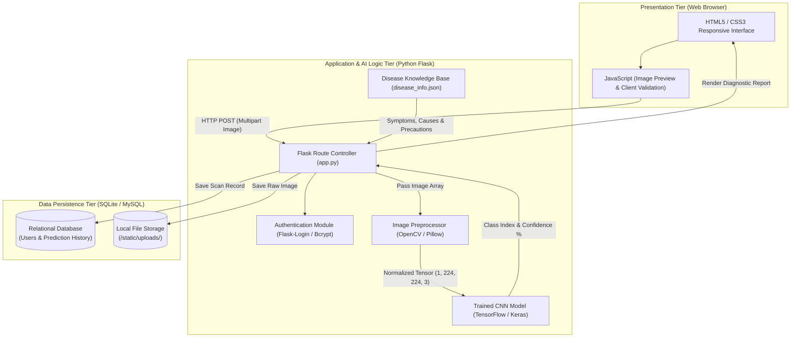
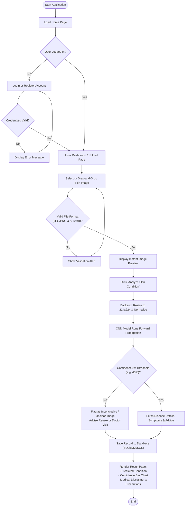

> **Note**: This document provides an exhaustive technical, architectural, and theoretical reference for the **AI-Based Skin Disease Detection System**. It is structured to directly align with standard academic project documentation (**Chapters 1 through 5**) to assist the students in drafting their project report, designing diagrams, and preparing for their defense.
>
> **Academic Project Attribution**:
> * **Institution**: Moshood Abiola Polytechnic (MAPOLY), Abeokuta, Ogun State, Nigeria
> * **Researchers**:
>   1. **Lawal Reinhard Oluwatimilehin**
>   2. **Ogunsanya David Iyanuoluwa**
> * **Project Supervisor**: **Mrs Adesina**

---

## 1. Project Overview & Academic Foundation (Chapter 1)

### 1.1 Suggested Academic Project Titles
Depending on the student's department (Computer Science, Software Engineering, Biomedical Engineering, or Information Technology), any of the following formal titles can be used:
1. *Design and Implementation of an AI-Based Skin Disease Detection and Classification System Using Convolutional Neural Networks (CNN).*
2. *Automated Dermatological Screening System for Early Identification of Common Skin Diseases Using Deep Learning.*
3. *A Web-Based Intelligent Decision Support System for Skin Lesion Diagnosis Using Transfer Learning.*

### 1.2 Abstract Template
> Skin diseases represent one of the most prevalent global health challenges, affecting millions of individuals across diverse demographics. Early and accurate identification is critical to preventing severe complications; however, access to certified dermatologists remains limited, particularly in underserved and rural regions, leading to delayed diagnosis and self-medication. This project presents the design and implementation of an **AI-Based Skin Disease Detection System** that leverages Deep Learning—specifically Convolutional Neural Networks (CNN) and Transfer Learning—to classify common dermatological conditions from digital skin images. Images uploaded by users undergo automated preprocessing using OpenCV and Pillow (resizing, normalization, and noise reduction) before being analyzed by a trained TensorFlow/Keras model capable of identifying conditions such as Acne, Eczema, Psoriasis, Ringworm (Tinea), Vitiligo, and Dermatitis. The model is integrated into a responsive web application built with the Python Flask framework, HTML5, CSS3, and JavaScript, backed by a relational database (SQLite/MySQL) for managing user accounts and historical diagnostic logs. In addition to displaying the predicted condition and probability confidence scores, the platform provides curated educational overviews and precautionary guidance while encouraging timely clinical consultation. Experimental evaluation demonstrates that integrating deep learning with an accessible web interface offers a fast, reliable, and cost-effective preliminary screening tool for both patients and primary healthcare workers.

### 1.3 Statement of the Problem
1. **Scarcity of Dermatologists**: In many developing regions and rural communities, the ratio of dermatologists to patients is critically low, resulting in long wait times and restricted access to specialist care.
2. **High Cost of Clinical Consultation**: Preliminary physical consultations and laboratory skin biopsies can be expensive for low-income individuals seeking to check minor or emerging skin rashes.
3. **Visual Similarity of Skin Lesions**: Many dermatological conditions (such as eczema, psoriasis, and fungal ringworm) share overlapping visual characteristics (erythema, scaling, papules), leading to frequent misdiagnosis by non-specialists and inappropriate over-the-counter self-medication.
4. **Delayed Early Screening**: Ignorance of early symptoms often causes patients to ignore progressive skin disorders until they become chronic, infectious, or malignant.

### 1.4 Aim and Objectives
**Aim**: To develop an intelligent, web-based skin disease detection system using Deep Learning (Convolutional Neural Networks) that provides rapid preliminary classification of common skin conditions from user-uploaded photographs.

**Specific Objectives**:
1. To collect, curate, and preprocess a labeled dataset of clinical skin disease images covering common conditions (*Acne, Eczema, Psoriasis, Ringworm, Vitiligo, and Dermatitis*).
2. To design, train, and optimize a Convolutional Neural Network (CNN) model using TensorFlow and Keras for multi-class skin image classification.
3. To evaluate the trained model's diagnostic performance using standard machine learning metrics including Accuracy, Precision, Recall, F1-Score, and a Confusion Matrix.
4. To develop an intuitive web interface using Flask, HTML, CSS, and JavaScript that enables users to upload skin images, preview them, and view real-time AI predictions with confidence scores.
5. To implement a relational database (SQLite/MySQL) to securely store user profiles, prediction history, and educational disease metadata.

### 1.5 Scope and Limitations
* **Scope**: The system covers macroscopic (clinical/smartphone camera) and dermoscopic images across 6 to 7 target skin disease classes. It provides user authentication, image upload, real-time classification, confidence percentage visualization, scan history tracking, and educational disease profiles.
* **Limitations**:
  * The system serves strictly as a **preliminary screening and decision-support tool**, not a replacement for certified clinical biopsy or medical diagnosis.
  * Prediction accuracy depends on the quality, lighting, focus, and resolution of the image uploaded by the user.
  * Rare genetic disorders or internal systemic symptoms not visible on the epidermis cannot be evaluated by visual inspection alone.

---

## 2. Theoretical Background & Deep Learning Concepts (Chapter 2)

### 2.1 How Convolutional Neural Networks (CNNs) Process Skin Images
Unlike traditional machine learning algorithms that require manual feature extraction (such as hand-crafting color histograms or edge filters), a **Convolutional Neural Network (CNN)** automatically learns hierarchical spatial features directly from raw pixel values:
1. **Low-Level Features (Early Layers)**: Detects edges, color gradients, borders, and pigment variations between healthy skin and lesions.
2. **Mid-Level Features (Middle Layers)**: Identifies textures, scaling patterns, pustules, ring-like borders (as seen in Ringworm), or silvery plaques (as seen in Psoriasis).
3. **High-Level Features (Deep Layers)**: Combines spatial textures and morphology into semantic representations to classify the specific dermatological disorder.

### 2.2 Mathematical Formulations (For Academic Write-Up)

#### 1. 2D Convolution Operation
Given an input RGB skin image tensor $I$ and a learnable convolutional filter (kernel) $K$ of size $M \times N$, the feature map $S(i, j)$ is computed as:

$$S(i, j) = (I * K)(i, j) = \sum_{m=0}^{M-1} \sum_{n=0}^{N-1} I(i + m, j + n) \cdot K(m, n) + b$$

where $b$ represents the learnable bias term.

#### 2. Rectified Linear Unit (ReLU) Activation
To introduce non-linearity into the network and prevent vanishing gradients, the ReLU activation function is applied element-wise:

$$f(x) = \max(0, x)$$

#### 3. Softmax Output Layer (Multi-Class Probability)
In the final classification layer with $C$ target disease classes, the **Softmax function** converts raw logit scores $z_i$ into a normalized probability distribution summing to $1.0$ ($100\%$):

$$P(y = i \mid x) = \sigma(z)_i = \frac{e^{z_i}}{\sum_{j=1}^{C} e^{z_j}}$$

#### 4. Categorical Cross-Entropy Loss Function
During training, model weights are updated by minimizing the Categorical Cross-Entropy loss between the true label $y_i$ and predicted probability $\hat{y}_i$:

$$\mathcal{L}(y, \hat{y}) = -\sum_{i=1}^{C} y_i \log(\hat{y}_i)$$

### 2.3 Transfer Learning Strategy (MobileNetV2 / EfficientNetB0)
Training a deep CNN from scratch requires hundreds of thousands of images and heavy GPU clusters. To achieve high accuracy on medical datasets, this project uses **Transfer Learning**:
* A base architecture pre-trained on **ImageNet** (1.4 million images) such as **MobileNetV2** or **EfficientNetB0** is loaded without its top classification layer (`include_top=False`).
* The foundational visual feature extractors are frozen during initial training epochs, and a custom classification head (`GlobalAveragePooling2D` -> `BatchNormalization` -> `Dropout(0.3)` -> `Dense(num_classes, activation='softmax')`) is trained on the skin disease dataset.

### 2.4 Target Skin Conditions Profiled by the System

| Class ID | Condition Name | Clinical / Visual Characteristics | Common Symptoms |
| :--- | :--- | :--- | :--- |
| **0** | **Acne Vulgaris** | Comedones (blackheads/whiteheads), red papules, pustules, or nodules primarily on face, chest, and back. | Localized inflammation, oiliness, tenderness, potential scarring. |
| **1** | **Eczema (Atopic Dermatitis)** | Dry, red, itchy, and inflamed patches with leathery texture (lichenification) or weeping crusts. | Intense pruritus (itching), redness, dry scaling, skin cracking. |
| **2** | **Psoriasis** | Well-demarcated erythematous (red) plaques covered with thick, silvery-white scales, often on elbows, knees, and scalp. | Silvery scales, plaque thickening, itching or burning sensation. |
| **3** | **Ringworm (Tinea Corporis)** | Characteristic annular (ring-shaped) red rash with a raised, scaly active border and central clearing. | Itchy circular rash, expanding ring border, hair loss in affected area. |
| **4** | **Vitiligo** | Well-defined, milky-white depigmented macules and patches caused by loss of epidermal melanocytes. | Painless loss of skin pigment, symmetrical white patches. |
| **5** | **Contact Dermatitis** | Acute erythema, edema, and small vesicles/blisters localized to areas exposed to an allergen or irritant. | Stinging, itching, localized redness, blistering rash. |
| **6** | **Normal / Healthy Skin** | Uniform pigmentation, intact epidermal barrier, absence of lesions, plaques, or inflammation. | None (control class to prevent false positives on clear skin). |

---

## 3. System Analysis & Methodology (Chapter 3)

### 3.1 Comparison of Existing vs. Proposed System

| Feature / Criteria | Existing System (Manual Consultation) | Proposed System (AI-Based Detection) |
| :--- | :--- | :--- |
| **Accessibility** | Restricted to clinic hours and urban hospitals. | Available 24/7 via any web browser or smartphone. |
| **Turnaround Time** | Days or weeks waiting for specialist appointment. | Instantaneous analysis (under 3 seconds per image). |
| **Preliminary Cost** | High consultation and registration fees. | Free/low-cost preliminary screening. |
| **Record Keeping** | Paper files or fragmented hospital records. | Automated digital prediction history with image logs. |
| **Objectivity** | Subject to human fatigue or general practitioner error. | Consistent quantitative probability/confidence scores. |

### 3.2 Step-by-Step Image Preprocessing & Augmentation:
1. **Format Verification & RGB Conversion**: Uploaded images (`.jpg`, `.jpeg`, `.png`) are read via **Pillow / OpenCV**. Any 4-channel `RGBA` or grayscale images are converted into standard 3-channel `RGB`.
2. **Spatial Resizing**: Every image is resized to a uniform dimension of $224 \times 224$ pixels using bilinear interpolation to match the input tensor shape $(1, 224, 224, 3)$ required by the CNN.
3. **Pixel Intensity Normalization**: Pixel values ranging from $[0, 255]$ are scaled to $[0, 1]$ (by dividing by $255.0$) or $[-1, 1]$ so gradients converge smoothly during training and inference.
4. **Data Augmentation (Training Phase Only)**: To prevent overfitting and make the model invariant to camera angles and lighting, real-time transformations are applied:
   * Random Horizontal and Vertical Flips
   * Random Rotation ($\pm 20^\circ$)
   * Random Zoom ($\pm 15\%$)
   * Random Brightness & Contrast Adjustments

---

## 4. System Design & Architecture (Chapters 3 & 4)

### 4.1 High-Level System Architecture
The system follows a **3-Tier Architecture** comprising the **Presentation Layer (Frontend)**, **Application & AI Logic Layer (Flask + TensorFlow)**, and **Data Persistence Layer (SQLite/MySQL)**.

### 4.2 End-to-End Application Flowchart (User Operational Flow)

### 4.3 Database Design & Schema Specification

#### Table 1: `users`
| Field Name | Data Type | Constraints | Description |
| :--- | :--- | :--- | :--- |
| `id` | `INTEGER` | `PRIMARY KEY, AUTOINCREMENT` | Unique identifier for each registered user. |
| `full_name` | `VARCHAR(100)` | `NOT NULL` | Full name of the patient or user. |
| `email` | `VARCHAR(120)` | `UNIQUE, NOT NULL` | User email address used for login. |
| `password_hash` | `VARCHAR(255)` | `NOT NULL` | Bcrypt encrypted password hash. |
| `created_at` | `DATETIME` | `DEFAULT CURRENT_TIMESTAMP` | Date and time of registration. |

#### Table 2: `prediction_history`
| Field Name | Data Type | Constraints | Description |
| :--- | :--- | :--- | :--- |
| `id` | `INTEGER` | `PRIMARY KEY, AUTOINCREMENT` | Unique scan record ID. |
| `user_id` | `INTEGER` | `FOREIGN KEY (users.id), NULLABLE` | Links scan to the authenticated user. |
| `image_filename` | `VARCHAR(255)` | `NOT NULL` | Relative file path of the uploaded image. |
| `predicted_class` | `VARCHAR(100)` | `NOT NULL` | Top predicted skin disease name. |
| `confidence_score` | `FLOAT` | `NOT NULL` | Confidence percentage ($0.0 - 100.0$). |
| `top_predictions_json` | `TEXT` | `NULLABLE` | JSON breakdown of top 3 probabilities. |
| `scanned_at` | `DATETIME` | `DEFAULT CURRENT_TIMESTAMP` | Date and time the scan was performed. |

---

## 5. System Implementation & Technology Justification (Chapter 4)

### 5.1 Hardware & Software Requirements

#### Hardware Requirements
| Component | Minimum Requirement (Client / Running App) | Recommended Requirement (Model Training) |
| :--- | :--- | :--- |
| **Processor (CPU)** | Intel Core i3 / AMD Ryzen 3 (2.0 GHz+) | Intel Core i7 / Ryzen 7 or Google Colab Cloud VM |
| **Memory (RAM)** | 4 GB RAM | 16 GB RAM |
| **Graphics (GPU)** | Integrated Graphics (CPU Inference supported) | NVIDIA GPU (Tesla T4 / RTX 3060+ with CUDA) |
| **Storage** | 2 GB free disk space | 15 GB+ free space (for image datasets & checkpoints) |
| **Camera / Input** | Smartphone camera or PC file upload | N/A |

#### Software Requirements
* **Operating System**: Windows 10/11, macOS, or Linux (Ubuntu 20.04+).
* **Programming Language**: Python 3.10 – 3.12.
* **Deep Learning Framework**: TensorFlow 2.15+ / Keras 3.0+.
* **Computer Vision Libraries**: OpenCV (`opencv-python-headless`), Pillow (`PIL`), NumPy.
* **Backend Web Framework**: Flask 3.0+, Flask-SQLAlchemy, Flask-Login, Flask-Bcrypt, Werkzeug.
* **Frontend Technologies**: HTML5, CSS3, Vanilla JavaScript (ES6+).
* **Database Engine**: SQLite 3 (Local Default) / MySQL 8.0+.
* **Development Tools**: Visual Studio Code, Jupyter Notebook / Google Colab.

---

## 6. System Testing & Performance Evaluation (Chapters 4 & 5)

### 6.1 Machine Learning Evaluation Metrics
* **True Positive ($TP$)**: Model correctly predicts a specific skin disease.
* **True Negative ($TN$)**: Model correctly identifies that an image does *not* belong to that class.
* **False Positive ($FP$ - Type I Error)**: Model falsely predicts a disease that is not present.
* **False Negative ($FN$ - Type II Error)**: Model fails to detect a disease that is actually present.

#### Formulas:
1. **Overall Accuracy**: $\text{Accuracy} = \frac{TP + TN}{TP + TN + FP + FN}$
2. **Precision**: $\text{Precision} = \frac{TP}{TP + FP}$
3. **Recall (Sensitivity)**: $\text{Recall} = \frac{TP}{TP + FN}$
4. **F1-Score**: $\text{F1-Score} = 2 \times \frac{\text{Precision} \times \text{Recall}}{\text{Precision} + \text{Recall}}$

### 6.2 Software System Test Cases (For Chapter 4 Testing Table)

| Test ID | Test Module | Test Description / Action | Input Data | Expected Output | Status |
| :--- | :--- | :--- | :--- | :--- | :--- |
| **TC-01** | User Registration | Register a new account with valid details. | Name, Email, Password (`>= 6` chars) | Account created in DB; redirects to Login/Dashboard. | Pass |
| **TC-02** | Authentication | Attempt login with unregistered email or wrong password. | Invalid Email/Password | Displays error alert: *"Invalid email or password."* | Pass |
| **TC-03** | File Validation | Upload an unsupported file format (e.g., `.pdf` or `.exe`). | `document.pdf` | Client & server reject upload; prompts for `.jpg` or `.png`. | Pass |
| **TC-04** | Image Preview | Select a valid `.jpg` skin image from device storage. | `eczema_sample.jpg` | Instant thumbnail preview renders on screen before submission. | Pass |
| **TC-05** | Image Preprocessing | Pass an arbitrary resolution image ($1920 \times 1080$ RGBA) to preprocessor. | High-res PNG image | Converted to RGB and resized cleanly to $(1, 224, 224, 3)$ tensor. | Pass |
| **TC-06** | AI Prediction | Submit a clear clinical image of Ringworm. | `ringworm_test.jpg` | Predicts *Ringworm (Tinea)* with confidence score and displays precautions. | Pass |
| **TC-07** | Scan History | Navigate to the *"Scan History"* tab while logged in. | Authenticated User Session | Displays chronological list of user's previous scans, images, and scores. | Pass |

---

## 7. Ethical Considerations, Conclusion & Future Work (Chapter 5)

### 7.1 Ethical & Medical Disclaimer
1. **Non-Diagnostic Advisory**: Every result page displays a prominent medical disclaimer stating that the output is an AI-generated probability estimate for educational and preliminary screening purposes only, and must be verified by a qualified dermatologist.
2. **Data Privacy**: Uploaded skin photographs are stored locally with randomized filenames (`UUID`) and associated strictly with the authenticated user's session.
3. **Skin Tone Diversity & Bias Mitigation**: Data augmentation (brightness and contrast variations) is utilized during training to reduce algorithmic bias across diverse Fitzpatrick skin phototypes.

### 7.2 Recommendations for Future Enhancement
1. **Explainable AI (Grad-CAM Heatmaps)**: Integrating Gradient-weighted Class Activation Mapping (Grad-CAM) to overlay a visual heatmap on the lesion, showing doctors *which exact pixels* caused the CNN to make its decision.
2. **Offline Mobile App Deployment**: Converting the Keras model to **TensorFlow Lite (`.tflite`)** so it can run offline on Android and iOS devices in rural clinics without internet access.
3. **Multimodal Symptom Integration**: Combining image analysis with a structured patient questionnaire (e.g., *"Does it itch?"*, *"How long has the rash been present?"*, *"Do you have a fever?"*) to fuse visual and clinical metadata.
4. **Tele-Dermatology Integration**: Adding a direct booking or referral module that sends the patient's scan report directly to a nearby clinic or dermatologist.
