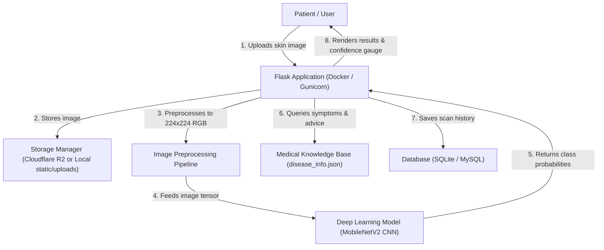

# DermAI - AI-Based Skin Disease Detection System

An intelligent healthcare application designed to assist in the early identification and visual screening of common dermatological conditions through Deep Learning (CNN / Transfer Learning), modern web interfaces, and cloud storage.

> 🎓 **Academic Research Project**  
> **Institution:** Moshood Abiola Polytechnic (MAPOLY), Abeokuta, Ogun State, Nigeria  
> **Student Researchers / Developers:**  
> - **Lawal Reinhard Oluwatimilehin**  
> - **Ogunsanya David Iyanuoluwa**  
> **Project Supervisor:** **Mrs Adesina**  

---

## 🌟 Key Features

* **Instant AI Visual Screening**: Upload or photograph skin lesions to receive rapid multi-class condition probabilities.
* **Target Conditions**:
  1. **Acne** (*Acne Vulgaris*)
  2. **Eczema** (*Atopic Dermatitis*)
  3. **Psoriasis** (*Psoriasis Vulgaris*)
  4. **Ringworm** (*Tinea Corporis*)
  5. **Vitiligo**
  6. **Melanoma** (*Malignant Melanoma - Critical Priority*)
  7. **Melanocytic Nevus** (*Common Benign Moles*)
  8. **Contact Dermatitis**
* **Dual Storage Strategy (Local + Cloudflare R2)**:
  * Zero-config local disk storage fallback for offline development.
  * Direct upload to **Cloudflare R2** (S3-compatible object storage) for production scalability.
* **Interactive Healthcare UI**:
  * Drag-and-Drop image uploader with live client-side preview.
  * Visual confidence gauges and top-4 probability ranking bars.
  * High-risk clinical warning indicators and emergency consultation guidelines.
* **Scan History Tracking**: Registered patients can track and review previous lesion scans.
* **Disease Encyclopedia**: Searchable and filterable medical database covering symptoms, causes, self-care routines, and doctor advisories.
* **REST API Endpoints**: Ready-to-integrate JSON API for mobile applications (`/api/v1/predict`, `/api/v1/diseases`).
* **Docker & Containerization**: Fully containerized with `Dockerfile` and `docker-compose.yml` for reproducible deployment across any operating system.

---

## 🏗️ System Architecture



---

## 📁 Project Directory Structure

```text
skin-disease-detection/
├── app.py                         # Flask entrypoint, routes, and REST API
├── config.py                      # Configurations (SQLite/MySQL, Secret Key, Cloudflare R2)
├── storage.py                     # Unified Cloudflare R2 & local storage manager
├── requirements.txt               # Dependencies (Flask, SQLAlchemy, Pillow, boto3, etc.)
├── .env.example                   # Template for environment variables
├── .gitignore                     # Git ignore rules
├── Dockerfile                     # Container definition for Python 3.11 + OpenCV + Flask
├── docker-compose.yml             # Container orchestration with volume mounts
├── .dockerignore                  # Docker build exclusions
│
├── database/
│   ├── __init__.py                # Database & auth extension initializers
│   └── models.py                  # SQLAlchemy models: User & PredictionHistory
│
├── models/
│   ├── disease_info.json          # Medical encyclopedia: symptoms, precautions, severity
│   ├── predictor.py               # Preprocessing, weights loader & demo fallback classifier
│   └── skin_disease_model.keras   # Exported trained CNN model weights (placed here)
│
├── notebooks/
│   └── model_training.ipynb       # Colab/Kaggle notebook for Transfer Learning training
│
├── templates/
│   ├── base.html                  # Master layout with navbar, footer, medical disclaimer
│   ├── index.html                 # Hero page & image upload / drag-and-drop interface
│   ├── result.html                # Prediction result, confidence gauge, precautions
│   ├── history.html               # User scan history & past records
│   ├── info.html                  # Skin disease encyclopedia & symptom library
│   └── auth/
│       ├── login.html             # User login page
│       └── register.html          # User registration page
│
└── static/
    ├── css/
    │   └── style.css              # Modern healthcare UI styling & animations
    ├── js/
    │   └── main.js                # Drag-and-drop upload, live preview, submission feedback
    └── uploads/                   # Local storage folder for uploaded scans (fallback)
```

---

## 🚀 Quickstart Guide

### Option 1: Running with Docker (Recommended)

Make sure [Docker Desktop](https://www.docker.com/) is installed and running, then execute:

```bash
# 1. Build and start the container
docker compose up --build

# 2. Access the application in your browser:
# http://localhost:5000
```

To run in detached background mode:
```bash
docker compose up -d
```

To stop containers:
```bash
docker compose down
```

---

### Option 2: Running Locally with Python Virtual Environment

#### 1. Create and Activate Virtual Environment
```bash
# Windows:
python -m venv .venv
.venv\Scripts\activate

# Linux / macOS:
python3 -m venv .venv
source .venv/bin/activate
```

#### 2. Install Dependencies
```bash
pip install -r requirements.txt
```

#### 3. Set Up Environment Variables
Copy `.env.example` to `.env`:
```bash
# Windows PowerShell:
Copy-Item .env.example .env

# Linux / macOS:
cp .env.example .env
```

#### 4. Run the Application
```bash
python app.py
```
Open your browser at **`http://127.0.0.1:5000`**.

---

## ☁️ Cloudflare R2 Storage Configuration

To enable storing uploaded skin images in **Cloudflare R2**:

1. Log into your [Cloudflare Dashboard](https://dash.cloudflare.com/) and navigate to **R2**.
2. Create an R2 bucket (e.g., `skin-disease-images`).
3. Under **Manage R2 API Tokens**, create a token with `Admin Read & Write` permissions.
4. Copy your:
   - **Account ID**
   - **Access Key ID**
   - **Secret Access Key**
5. Edit your `.env` file:
   ```env
   CLOUDFLARE_R2_ENABLED=true
   R2_ACCOUNT_ID=your_cloudflare_account_id
   R2_ACCESS_KEY_ID=your_r2_access_key_id
   R2_SECRET_ACCESS_KEY=your_r2_secret_access_key
   R2_BUCKET_NAME=skin-disease-images
   R2_PUBLIC_URL=https://pub-your-bucket-id.r2.dev
   ```
6. Restart the application. Images will now upload directly to Cloudflare R2! If credentials are unset or the network fails, the system automatically falls back to local storage.

---

## 🧠 Model Training (Google Colab / GPU)

The project includes an end-to-end training notebook at `notebooks/model_training.ipynb`.

1. Open **[Google Colab](https://colab.research.google.com/)** or **Kaggle**.
2. Upload `notebooks/model_training.ipynb`.
3. Set your runtime to **GPU** (`Runtime` -> `Change runtime type` -> `T4 GPU`).
4. Train the model on your chosen dataset (e.g., HAM10000 or DermNet).
5. Download the exported `skin_disease_model.keras` and place it inside the `models/` folder:
   ```text
   models/skin_disease_model.keras
   ```
6. Restart `app.py`. The app will automatically detect and load your trained weights!

> **Note**: If `models/skin_disease_model.keras` is not yet added, the application operates using its **smart heuristic demo classifier**, allowing you to test, demo, and present the entire web application, database, and cloud storage immediately.

---

## 📡 REST API Documentation

### 1. Predict Lesion from Image
* **URL**: `/api/v1/predict`
* **Method**: `POST`
* **Content-Type**: `multipart/form-data`
* **Body**: `image` (binary file)
* **Response**:
  ```json
  {
    "id": 1,
    "image_url": "/static/uploads/7a8b9c_skin_lesion.jpg",
    "storage_type": "local",
    "prediction": {
      "class_id": "eczema",
      "disease_name": "Eczema",
      "confidence": 92.4,
      "is_trained_model": false,
      "inference_mode": "demo_heuristic",
      "top_breakdown": [
        {"class_id": "eczema", "name": "Eczema", "probability": 92.4, "risk_level": "Moderate"}
      ]
    }
  }
  ```

### 2. Get All Disease Encyclopedia Details
* **URL**: `/api/v1/diseases`
* **Method**: `GET`
* **Response**: Full JSON object of supported conditions and medical advice.

### 3. Service Health Check
* **URL**: `/health`
* **Method**: `GET`
* **Response**: `{"service": "skin-disease-detection", "status": "healthy"}`

---

## ⚖️ Medical Disclaimer

> **IMPORTANT**: This application is built as an academic, educational, and preliminary screening tool. It is **NOT** a certified medical diagnostic device. It should never be used as a substitute for professional clinical diagnosis, biopsy, or medical treatment. Always consult a certified dermatologist or licensed medical practitioner for health concerns.
